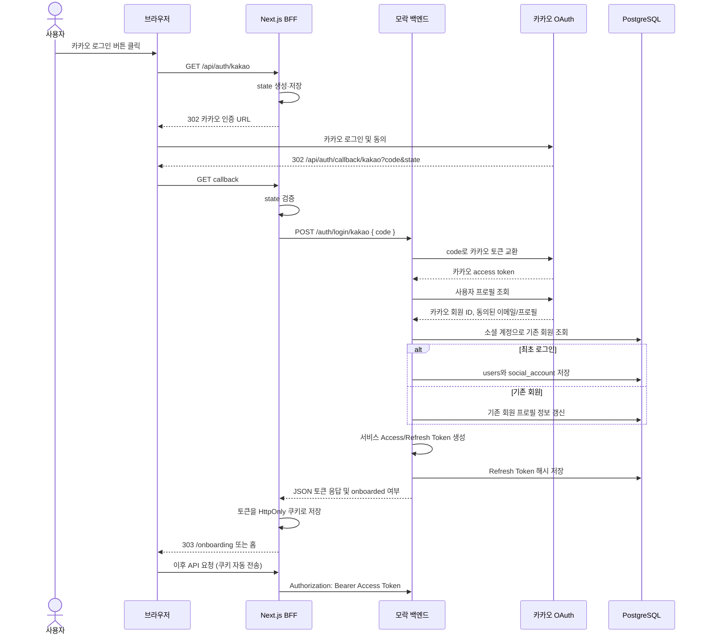
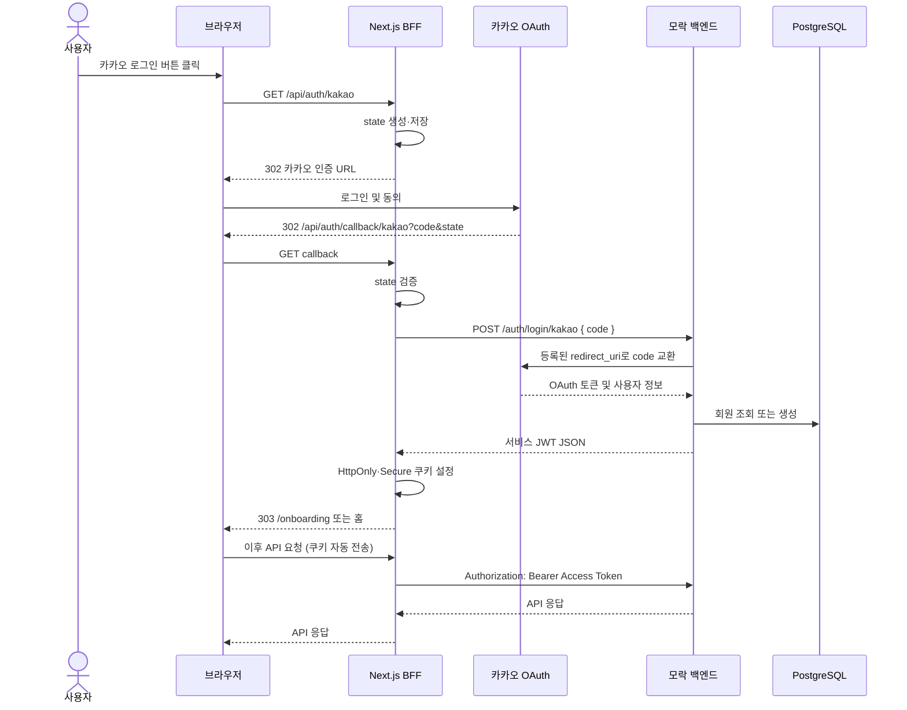

# 카카오 로그인 구현 정리

## 목적과 현재 범위

카카오 OAuth 인증을 통해 사용자를 식별하고, 최초 로그인이라면 회원과 소셜 계정 정보를 저장한다. 로그인 성공 시 모락 서비스의 Access Token과 Refresh Token, 온보딩 완료 여부를 반환한다.

현재 백엔드는 provider 인가 코드를 받아 회원 생성/조회와 서비스 토큰 발급을 처리한다. OAuth 시작과 callback은 Next.js BFF가 담당한다. Refresh Token 재발급과 로그아웃 API는 아직 구현하지 않았다.

## API

| 메서드 | 경로 | 설명 |
| --- | --- | --- |
| `POST` | `/auth/login/{provider}` | Next.js BFF가 provider 인가 코드를 전달한다. 백엔드는 provider 토큰 교환, 사용자 조회/생성, 서비스 토큰 발급을 처리한다. 현재 지원 provider는 `kakao`다. |

`POST /auth/login/kakao` 요청:

```json
{
  "code": "Next.js BFF callback이 받은 카카오 인가 코드"
}
```

로그인 성공 응답:

```json
{
  "success": true,
  "data": {
    "accessToken": "서비스 Access Token",
    "refreshToken": "서비스 Refresh Token",
    "tokenType": "Bearer",
    "accessTokenExpiresIn": 1800,
    "accessTokenExpiresAt": "2026-11-02T12:30:00Z",
    "onboarded": false
  },
  "error": null
}
```

응답의 토큰은 민감 정보다. 문서 예시 외 실제 토큰을 로그나 이슈에 공유하지 않는다. `onboarded`가 `false`면 프론트는 온보딩 화면으로, `true`면 로그인 후 화면으로 보낸다.

## BFF 로그인 흐름



Next.js BFF가 OAuth state 검증과 provider callback을 담당한다. 백엔드에는 authorization code만 전달하고, 백엔드는 토큰 JSON을 BFF에 응답한다. BFF는 토큰을 HttpOnly 쿠키로 저장하며 URL에는 토큰을 넣지 않는다.

## 코드 구조와 책임

| 위치 | 책임 |
| --- | --- |
| `auth/presentation/controller/AuthController` | 인가 코드 로그인 HTTP 요청 처리 (`POST /auth/login/{provider}`) |
| `auth/application/service/KakaoLoginService` | 소셜 제공자에서 프로필을 가져오고 예외를 애플리케이션 오류로 변환 |
| `auth/application/service/CompleteSocialLoginService` | 트랜잭션 내 회원·소셜 계정 확인/생성, 프로필 갱신, 토큰 발급 및 저장 |
| `auth/application/port/out` | OAuth 제공자와 서비스 토큰 발급 기능의 애플리케이션 경계(interface) 정의 |
| `auth/infrastructure/oauth/KakaoOAuthClient` | 카카오 토큰 교환 및 사용자 프로필 HTTP 호출 |
| `auth/infrastructure/token/ServiceTokenProvider` | JWT/랜덤 Refresh Token 생성, Refresh Token SHA-256 해시 생성 |
| `auth/infrastructure/persistence` | 도메인 Repository를 Spring Data JPA로 구현 |
| `user/domain/entity/User` | 회원 상태와 프로필 데이터, 온보딩 완료 상태 보유 |

외부 카카오 HTTP 호출은 DB 트랜잭션 바깥에서 수행한다. 회원 및 Refresh Token 저장 작업만 `CompleteSocialLoginService`의 트랜잭션으로 처리한다.

## 데이터와 토큰

- 최초 로그인에서 `users`에 회원을 만들고 `social_account`에 `KAKAO`와 카카오 사용자 ID를 연결한다.
- 재로그인에서는 같은 제공자와 사용자 ID로 기존 회원을 찾으므로 회원을 중복 생성하지 않는다.
- 카카오가 동의된 이메일이나 프로필 이미지를 반환하면 기존 회원에도 값을 갱신한다. 제공되지 않은 값은 덮어쓰지 않는다.
- Access Token은 HS256 JWT이며 회원 ID와 `onboarded` claim을 포함한다. 기본 유효기간은 30분이다.
- Refresh Token은 무작위 값으로 발급하고 원문은 DB에 저장하지 않는다. SHA-256 해시만 `refresh_token`에 저장하며 기본 유효기간은 30일이다.
- 로그인할 때마다 새 Refresh Token 레코드가 생긴다. 현재 로그아웃·재발급 API가 없어 이전 토큰은 만료 전까지 유효하다.

## 설정값

실제 비밀 값은 프로젝트 루트의 `.env`에 두고 커밋하지 않는다. `.env.example`에는 키 이름과 로컬 테스트용 기본 callback만 둔다.

| 변수 | 용도 |
| --- | --- |
| `DB_URL`, `DB_USERNAME`, `DB_PASSWORD` | PostgreSQL 연결 |
| `KAKAO_REST_API_KEY` | 카카오 REST API 키 |
| `KAKAO_CLIENT_SECRET` | 카카오 앱에서 활성화한 경우 사용하는 Client Secret |
| `KAKAO_REDIRECT_URI` | 카카오 콘솔에 등록한 Next.js BFF callback URI와 정확히 일치해야 함. 로컬 기본값은 `http://localhost:3000/api/auth/callback/kakao` |
| `JWT_SECRET` | HS256 서명키, 32자 이상 |

## 검증 현황과 다음 작업

- BFF API 전환 이후 빌드 및 연동 검증은 진행해야 한다.
- 로컬 PostgreSQL에서 카카오 신규 로그인, 토큰 응답, 회원 저장, 이메일 동의 후 이메일 저장을 확인했다.
- 같은 카카오 계정으로 재로그인해 회원이 중복 생성되지 않는 것을 확인했다.
- Refresh Token 재발급, 로그아웃은 별도 작업이다.

## 프론트 BFF 방식과 백엔드 주도 방식 비교

프론트엔드가 Next.js를 사용하므로 Next.js Route Handler를 BFF(Backend for Frontend)로 둘 수 있다. BFF는 브라우저와 모락 백엔드 사이에서 토큰을 보관하고 API 요청을 중계한다.

| 항목 | Next.js BFF | 현재 백엔드 주도 OAuth |
| --- | --- | --- |
| 로그인 시작 | 브라우저가 `/api/auth/kakao` 등 Next.js route로 이동 | 브라우저가 백엔드 `/auth/login/kakao`로 이동 |
| OAuth callback | Next.js `/api/auth/callback/{provider}`가 인가 코드 수신 | 백엔드 callback이 인가 코드를 수신 (전환 전 방식) |
| 토큰 전달 | BFF가 백엔드 로그인 API를 호출하고 JWT를 HttpOnly 쿠키에 저장 | 백엔드가 브라우저 응답으로 토큰 반환 (전환 전 방식) |
| 후속 API 요청 | 브라우저는 Next.js API만 호출하고, BFF가 쿠키의 Access Token을 Bearer로 백엔드에 전달 | 브라우저가 Access Token으로 백엔드 API 직접 호출 (전환 전 방식) |
| 프론트 작업량 | 큼: OAuth 시작/callback, state, 쿠키, API proxy, refresh/logout route | 작음: 로그인 이동 및 토큰 요청 |
| 토큰 노출 | HttpOnly 쿠키를 쓰고 BFF가 중계하면 브라우저 JavaScript에서 JWT를 읽지 않음 | JWT가 프론트 JavaScript에 전달되므로 XSS가 발생하면 탈취 위험이 커짐 |
| 운영 고려 | BFF 서버 배포·쿠키/CORS·CSRF·refresh/logout 중계 필요 | 브라우저와 백엔드 간 인증·토큰 보관 책임 필요 |

### Next.js BFF 권장 흐름



### BFF에서 백엔드와 합의할 API 계약

프론트 BFF는 다음 API를 호출한다.

```http
POST /auth/login/{provider}
Content-Type: application/json

{"code":"provider authorization code"}
```

성공 응답 바디에는 `accessToken`, `refreshToken`, `tokenType`, `accessTokenExpiresIn`, `onboarded`를 포함한다. BFF가 응답 토큰을 HttpOnly 쿠키로 저장하고, `onboarded`에 따라 `/onboarding` 또는 홈으로 이동한다. 토큰은 URL에 넣지 않는다.

인가 코드 교환에 쓰는 `redirect_uri`는 카카오/구글에 등록한 Next.js callback URI와 정확히 같아야 하며, 백엔드는 provider별로 허용한 URI를 서버 설정에서 사용해야 한다. 프론트가 요청마다 임의 URI를 넘겨 백엔드가 그대로 신뢰하게 하지 않는다.

BFF가 호출할 백엔드에는 추후 `POST /auth/refresh`, `POST /auth/logout`도 필요하다. 이번 작업에는 로그인 API 전환만 포함한다. 브라우저의 일반 API 요청도 Next.js BFF를 거치게 해야 HttpOnly 쿠키의 Access Token을 서버 측에서 사용하고 갱신할 수 있다.

### 선택: Next.js BFF 방식

이번 프로젝트는 **Next.js BFF 방식으로 진행한다.** 백엔드 주도 방식보다 프론트에 구현할 route가 많아지지만, JWT를 브라우저 JavaScript에 노출하지 않고 HttpOnly 쿠키로 관리할 수 있어 보안상 이점이 더 크다고 판단했다. 프론트 이슈도 BFF callback, HttpOnly 쿠키, refresh/logout route를 전제로 작성되어 있어 팀의 구현 방향과도 일치한다.

BFF가 로그인 흐름을 중계하고 토큰을 서버 측에서 관리한다. 브라우저는 BFF에 같은 출처 요청을 보내고, BFF가 Access Token을 `Authorization: Bearer` 헤더에 넣어 백엔드 API를 호출한다. 현재 백엔드는 `POST /auth/login/{provider}`를 제공한다. `POST /auth/refresh`와 `POST /auth/logout`은 후속 작업이다.

프론트 구현량과 BFF 운영 비용이 추가되는 점은 감수한다. BFF callback에서 state를 검증하고 쿠키를 안전하게 구성하며, 쿠키 인증을 사용하는 쓰기 요청에는 CSRF 방어도 적용한다. OAuth 브라우저 보안 권장사항은 [RFC 9700](https://www.rfc-editor.org/rfc/rfc9700/)과 [브라우저 기반 OAuth 앱 가이드](https://www.rfc-editor.org/info/rfc10017/)를 참고한다.
